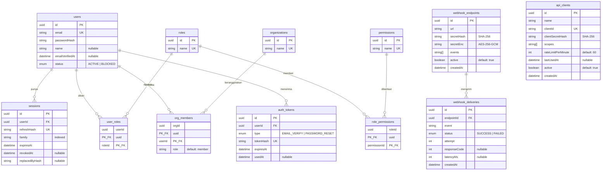

# Data Model — ums-service

PostgreSQL via Prisma 6. Sumber kebenaran: `prisma/schema.prisma` (12 model, 3 enum).
Diagram di bawah digenerate ulang dari schema — jika schema berubah, perbarui dokumen ini di PR yang sama.

## ERD

## Invariant

1. **Refresh token tidak pernah tersimpan apa adanya.** `sessions.refreshHash` adalah SHA-256 dan
   bersifat unik. Rotasi mengisi `replacedByHash` dan `revokedAt`.
2. **Satu family = satu rantai sesi.** Memakai ulang token yang sudah dirotasi mencabut seluruh
   `family`, bukan satu baris saja.
3. **Password hanya sebagai argon2id hash** di `users.passwordHash`; tidak ada kolom plaintext.
4. **Semua relasi ke `users` cascade on delete** — menghapus user menghapus sesi, role assignment,
   keanggotaan org, dan auth token miliknya.
5. **Junction memakai composite primary key**, bukan surrogate id: `user_roles(userId, roleId)`,
   `role_permissions(roleId, permissionId)`, `org_members(orgId, userId)`.
6. **`auth_tokens.usedAt` sekali pakai** — token yang sudah terpakai tidak boleh diterima lagi.
7. **Client secret M2M hanya sebagai SHA-256** di `api_clients.clientSecretHash`; nilai mentah
   hanya dikembalikan sekali saat pembuatan client.
8. **Webhook signing secret tidak tersimpan mentah.** `webhook_endpoints.secretHash` adalah
   SHA-256 (untuk verifikasi), dan `secretEnc` adalah ciphertext AES-256-GCM yang didekripsi
   hanya di dalam proses untuk menghitung `X-Signature` (`HMAC-SHA256`). Kunci enkripsi
   diturunkan via HKDF dari key material JWT yang sama, sehingga rotasi kunci JWT membuat
   `secretEnc` lama tidak dapat didekripsi (endpoint harus di-register ulang).
9. **Satu baris `webhook_deliveries` per percobaan.** `attempt` menandai urutan (1..3);
   percobaan berhenti pada status `SUCCESS` pertama. Relasi ke `webhook_endpoints` cascade
   on delete.

## Index

- `sessions(userId)` dan `sessions(family)` — pencarian sesi per user dan pencabutan satu family.
- `auth_tokens(userId, type)` — composite, untuk mencari token verifikasi/reset aktif per user.
- `webhook_deliveries(endpointId, createdAt)` — composite, membaca riwayat pengiriman per endpoint.
- Unique: `users.email`, `roles.name`, `permissions.name`, `organizations.name`,
  `sessions.refreshHash`, `auth_tokens.tokenHash`, `api_clients.clientId`.

## Kebijakan migrasi

- Migrasi dibuat dengan `bunx prisma migrate dev`, diterapkan produksi dengan
  `bunx prisma migrate deploy`. Jangan pernah mengedit SQL migrasi yang sudah ter-commit.
- Migrasi yang menghapus kolom atau tabel wajib menyertakan rencana rollback di deskripsi PR.
- Seed (`bun run seed`) bersifat idempoten (upsert) dan membuat role `ums:admin`, satu organisasi,
  dan user admin dari `UMS_ADMIN_EMAIL/PASSWORD/NAME`.

## Ketegangan desain yang masih terbuka

- ~~**Dua mekanisme peran berdampingan.**~~ **Sudah diputuskan** (ADR 0003, 19 Okt 2026):
  **role bersifat global, bukan per-organisasi.** `user_roles` adalah satu-satunya sumber kebenaran
  peran otorisasi, dan klaim `roles[]` cukup untuk keputusan akses. `org_members.role` **bukan**
  peran otorisasi — ia hanya penanda keanggotaan dan tidak boleh dipakai sebagai dasar izin oleh
  service manapun. Tidak ada perubahan skema yang diperlukan.
  Tindak lanjut yang masih terbuka: membatasi nilai `org_members.role` dengan enum atau
  menghapusnya, supaya tidak terus disalahpahami.
- **`orgs[]` di klaim token berisi nama organisasi**, bukan id. Mengganti nama organisasi karena itu
  bersifat breaking bagi consumer.
- **Tidak ada soft delete.** Penghapusan bersifat permanen dan cascade.

## Celah skema terhadap desain

Dipetakan dari desain Stitch "Enterprise UMS Dashboard" (19 Oktober 2026). Ini **bukan rencana
migrasi** — ini catatan jarak, supaya tidak ada yang mengira layar desain bisa dibuat tanpa menyentuh
database.

Tabel yang perlu ada jika desain dikejar seluruhnya:

- **MFA** — faktor terdaftar per user, enrolment WebAuthn/passkey (credential id, public key,
  counter), recovery code. Minimal 2–3 tabel; ini bounded context baru, bukan kolom tambahan.
- **Audit log** — peristiwa, severity, actor dan subject, origin IP, geo, client agent, status.
  Volume tinggi; kebijakan retensi menentukan apakah cukup Postgres atau perlu sink terpisah
  (Loki sudah tersedia di platform).
- **OAuth client** — client id, secret ter-hash, scope, rate limit, CIDR allowlist, last used.
- **Webhook endpoint + delivery log** — URL, secret penandatangan, status pengiriman, latensi,
  percobaan ulang.
- **Security policy** — konfigurasi faktor yang diizinkan, TTL token, batas sesi bersamaan, aturan
  risiko. Sebagian bisa jadi konfigurasi, bukan tabel.
- **Federation / IdP** — konfigurasi SAML/OIDC per organisasi: ACS URL, entity id, sidik jari
  sertifikat, pemetaan klaim→role.
- **Billing** — langganan, invoice, alokasi kursi.

Perubahan pada tabel yang **sudah ada**:

- `Session` — desain menampilkan "Last Active", sedangkan tabel ini tidak punya `lastUsedAt`.
  Rotasi refresh token membuat baris baru, jadi aktivitas terakhir hanya bisa didekati dari
  `createdAt` sesi terbaru dalam satu `family`. Penambahan `lastUsedAt` diputuskan di epic 002
  slice 1.
- `Session` — kolom Geolocation dan Risk Score di desain **tidak punya sumber data**. Geo butuh
  lookup Geo-IP; risk score butuh device fingerprint dan riwayat geo-velocity. Keduanya di luar
  cakupan epic 002, dan **tidak boleh diisi tebakan** — admin mengambil keputusan pencabutan
  berdasarkan kolom itu.
- `Permission` — desain memakai penamaan berpola `users:read.profile`, `crypto:keys.rotate`, dengan
  pengelompokan wildcard `iam:users:*`. Nama permission sekarang bebas. Lihat
  `docs/02-patterns.md`.
- `OrgMember.role` — desain menampilkan "Realm Admin — DELEGATED", yaitu role yang dibatasi per
  organisasi. Konflik dengan ADR 0003 **sudah diselesaikan** (ADR 0005, 19 Oktober 2026):
  **role tetap global**, `user_roles` **tidak** ditambah `orgId`, dan klaim token tidak berubah.
  "Realm Admin" menjadi role global `ums:realm-admin`, dan pembatasan per-organisasi ditegakkan di
  **lapisan query** — setiap endpoint yang bisa diakses role itu wajib memfilter berdasarkan
  keanggotaan `OrgMember` pemanggil. Risikonya berpindah ke query, jadi pembatasan ini **wajib punya
  test per endpoint**, bukan sekadar konvensi.
