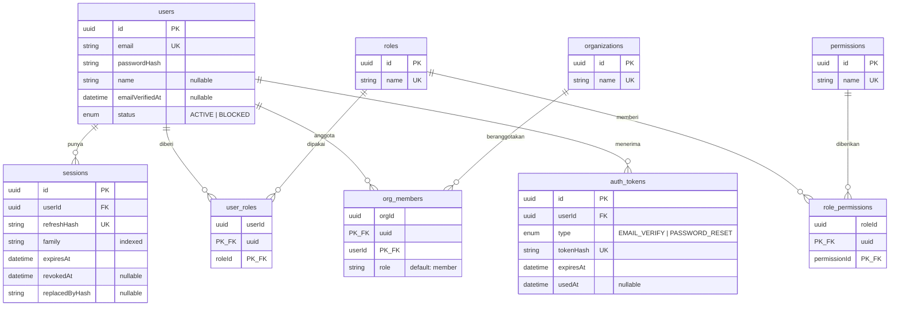

# Data Model — ums-service

PostgreSQL via Prisma 6. Sumber kebenaran: `prisma/schema.prisma` (9 model, 2 enum).
Diagram di bawah digenerate ulang dari schema — jika schema berubah, perbarui dokumen ini di PR yang sama.

## ERD

## Invariant

1. **Refresh token tidak pernah tersimpan apa adanya.** `sessions.refreshHash` adalah SHA-256 dan
   bersifat unik. Rotasi mengisi `replacedByHash` dan `revokedAt`.
2. **Satu family = satu rantai sesi.** Memakai ulang token yang sudah dirotasi mencabut seluruh
   `family`, bukan satu baris saja.
3. **Password hanya sebagai argon2id hash** di `users.passwordHash`; tidak ada kolom plaintext.
4. **Semua relasi ke `users` cascade on delete** — menghapus user menghapus sesi, role assignment,
   keanggotaan org, dan auth token miliknya.
5. **Junction memakai composite primary key**, bukan surrogate id: `user_roles(userId, roleId)`,
   `role_permissions(roleId, permissionId)`, `org_members(orgId, userId)`.
6. **`auth_tokens.usedAt` sekali pakai** — token yang sudah terpakai tidak boleh diterima lagi.

## Index

- `sessions(userId)` dan `sessions(family)` — pencarian sesi per user dan pencabutan satu family.
- `auth_tokens(userId, type)` — composite, untuk mencari token verifikasi/reset aktif per user.
- Unique: `users.email`, `roles.name`, `permissions.name`, `organizations.name`,
  `sessions.refreshHash`, `auth_tokens.tokenHash`.

## Kebijakan migrasi

- Migrasi dibuat dengan `bunx prisma migrate dev`, diterapkan produksi dengan
  `bunx prisma migrate deploy`. Jangan pernah mengedit SQL migrasi yang sudah ter-commit.
- Migrasi yang menghapus kolom atau tabel wajib menyertakan rencana rollback di deskripsi PR.
- Seed (`bun run seed`) bersifat idempoten (upsert) dan membuat role `ums:admin`, satu organisasi,
  dan user admin dari `UMS_ADMIN_EMAIL/PASSWORD/NAME`.

## Ketegangan desain yang masih terbuka

- **Dua mekanisme peran berdampingan:** `Role.name` unik **global** lewat `user_roles`, sementara
  `org_members.role` adalah **string bebas** dengan default `member`. Belum ada aturan yang
  menentukan mana yang menang saat keduanya menyebut peran untuk user yang sama.
- **`orgs[]` di klaim token berisi nama organisasi**, bukan id. Mengganti nama organisasi karena itu
  bersifat breaking bagi consumer.
- **Tidak ada soft delete.** Penghapusan bersifat permanen dan cascade.
