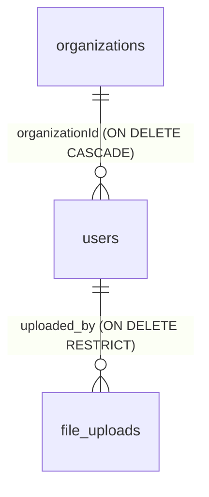

# DB Design — File Upload Service (v1)

| Field        | Value                                                                  |
| ------------ | ---------------------------------------------------------------------- |
| Database     | PostgreSQL (single database, accessed via Prisma v6)                   |
| Version      | v1 — target design for implementation                                  |
| Date         | 2026-10-13                                                             |
| Related docs | `docs/PRD.md` (requirements), `docs/API_CONTRACT.md` (API field usage) |

## 1. Overview

The service uses one PostgreSQL database managed through Prisma v6 (`prisma migrate` for schema changes). The database stores **metadata only** — file binaries live in MinIO (bucket `app-uploads`). This document covers:

- the two **existing template tables** (`users`, `organizations`), documented as they exist at HEAD — cross-checked against `prisma/schema.prisma` and the applied migrations in `prisma/migrations/`;
- the **new `file_uploads` table** for the file-upload feature;
- the Prisma model mapping, a raw SQL DDL sketch, and design notes.

## 2. Existing tables (from the template)

### 2.1 `users`

| Column                  | Type         | Constraints / default                                    | Notes                                                                                                                                                                          |
| ----------------------- | ------------ | -------------------------------------------------------- | ------------------------------------------------------------------------------------------------------------------------------------------------------------------------------ |
| `id`                    | TEXT         | PK                                                       | uuid value, generated client-side (Prisma `@default(uuid())`)                                                                                                                  |
| `email`                 | TEXT         | NOT NULL, UNIQUE (`users_email_key`)                     |                                                                                                                                                                                |
| `password`              | TEXT         | NOT NULL                                                 | bcrypt hash                                                                                                                                                                    |
| `firstName`             | TEXT         | nullable                                                 |                                                                                                                                                                                |
| `lastName`              | TEXT         | nullable                                                 |                                                                                                                                                                                |
| `isActive`              | BOOLEAN      | NOT NULL, DEFAULT `true`                                 | exists but is never checked by current code                                                                                                                                    |
| `forgotPasswordRequest` | BOOLEAN      | NOT NULL, DEFAULT `false`                                | **obsolete once the email flows are removed (PRD §7) — drop candidate.** This doc only flags it; no removal SQL is invented here — dropping is an implementation-time decision |
| `role`                  | `"RoleName"` | NOT NULL, DEFAULT `'USER'`                               | PG enum: `SYSTEM` / `ADMIN` / `USER`                                                                                                                                           |
| `createdAt`             | TIMESTAMP(3) | NOT NULL, DEFAULT `CURRENT_TIMESTAMP`                    |                                                                                                                                                                                |
| `updatedAt`             | TIMESTAMP(3) | NOT NULL                                                 | app-maintained (Prisma `@updatedAt`)                                                                                                                                           |
| `organizationId`        | TEXT         | NOT NULL, FK → `organizations(id)` **ON DELETE CASCADE** | required — every user belongs to exactly one organization                                                                                                                      |

### 2.2 `organizations`

| Column      | Type         | Constraints / default                       |
| ----------- | ------------ | ------------------------------------------- |
| `id`        | TEXT         | PK (uuid value)                             |
| `name`      | TEXT         | NOT NULL                                    |
| `slug`      | TEXT         | NOT NULL, UNIQUE (`organizations_slug_key`) |
| `logoUrl`   | TEXT         | nullable                                    |
| `createdAt` | TIMESTAMP(3) | NOT NULL, DEFAULT `CURRENT_TIMESTAMP`       |
| `updatedAt` | TIMESTAMP(3) | NOT NULL (app-maintained)                   |

### 2.3 Relationships



- **Organization 1 — many User** (cascade): deleting an organization deletes its users. The template's register flow auto-creates one organization per user, so today each user effectively owns a single-org tenant.
- **User 1 — many FileUpload** (restrict, new): see §3.

## 3. New table: `file_uploads`

### 3.1 Column spec

| Column          | Type        | Constraints / default                                                  |
| --------------- | ----------- | ---------------------------------------------------------------------- |
| `id`            | uuid\*      | PK, DEFAULT `gen_random_uuid()`                                        |
| `bucket`        | TEXT        | NOT NULL, DEFAULT `'app-uploads'`                                      |
| `object_key`    | TEXT        | NOT NULL, UNIQUE                                                       |
| `original_name` | TEXT        | NOT NULL                                                               |
| `mime_type`     | TEXT        | NOT NULL                                                               |
| `size_bytes`    | INTEGER     | NOT NULL, CHECK (`size_bytes > 0`)                                     |
| `checksum`      | TEXT        | NOT NULL — sha256 hex (64 chars)                                       |
| `status`        | TEXT        | NOT NULL, DEFAULT `'ACTIVE'`, CHECK (`status IN ('ACTIVE','DELETED')`) |
| `uploaded_by`   | uuid\*      | NOT NULL, REFERENCES `users(id)` **ON DELETE RESTRICT**                |
| `created_at`    | TIMESTAMPTZ | NOT NULL, DEFAULT `now()`                                              |
| `updated_at`    | TIMESTAMPTZ | NOT NULL — app-maintained (Prisma `@updatedAt`)                        |

\* **Type note (uuid vs TEXT):** the spec above describes `id` and `uploaded_by` as uuid semantically, but the template stores **all ids as TEXT** (Prisma `String` without `@db.Uuid` — see §2), and a FK column must match the referenced column's type. Therefore both columns are **TEXT holding uuid values**; a strictly `uuid`-typed DDL would first require altering `users.id` (out of scope for v1). The DDL sketch casts `gen_random_uuid()::text`; the Prisma model uses client-side `@default(uuid())` (template style) — either satisfies "uuid PK".

### 3.2 Indexes

| Index                          | Definition                          | Purpose                                                                                   |
| ------------------------------ | ----------------------------------- | ----------------------------------------------------------------------------------------- |
| `idx_file_uploads_uploaded_by` | `ON file_uploads (uploaded_by)`     | PostgreSQL does not auto-index FK columns; needed for per-user lists and ownership checks |
| `idx_file_uploads_created_at`  | `ON file_uploads (created_at DESC)` | serves the default list sort `createdAt:desc`                                             |
| `idx_file_uploads_checksum`    | `ON file_uploads (checksum)`        | integrity/audit lookups by checksum                                                       |

(`object_key`'s UNIQUE constraint is automatically backed by a unique b-tree index.)

## 4. Prisma model mapping

```prisma
model FileUpload {
  id           String   @id @default(uuid())
  bucket       String   @default("app-uploads")
  objectKey    String   @unique @map("object_key")
  originalName String   @map("original_name")
  mimeType     String   @map("mime_type")
  sizeBytes    Int      @map("size_bytes")
  checksum     String
  status       String   @default("ACTIVE")
  uploadedBy   String   @map("uploaded_by")
  createdAt    DateTime @default(now()) @map("created_at") @db.Timestamptz(6)
  updatedAt    DateTime @updatedAt @map("updated_at") @db.Timestamptz(6)

  uploader User @relation(fields: [uploadedBy], references: [id], onDelete: Restrict)

  @@index([uploadedBy])
  @@index([createdAt(sort: Desc)])
  @@index([checksum])
  @@map("file_uploads")
}
```

`model User` gains the back-relation: `fileUploads FileUpload[]`.

Notes:

- **CHECK constraints have no Prisma schema syntax** (`size_bytes > 0`, `status IN ('ACTIVE','DELETED')`). They must be added by hand-editing the SQL of the migration generated by `npx prisma migrate dev` (or a follow-up raw SQL migration). App-layer validation (DTO + MIME whitelist) remains the first line of defense regardless.
- `@default(uuid())` is client-side, matching the template's `User`/`Organization` models; the DB-side equivalent is `gen_random_uuid()::text` (§5).
- `@db.Timestamptz(6)` is deliberate: new tables use `timestamptz`, unlike the template's `timestamp(3)` columns (see design note 8).

**Field mapping (DB column ↔ Prisma field ↔ API field):**

| DB column (`file_uploads`) | Prisma field   | API field (`FileUpload` object)                                          |
| -------------------------- | -------------- | ------------------------------------------------------------------------ |
| `id`                       | `id`           | `id`                                                                     |
| `bucket`                   | `bucket`       | `bucket`                                                                 |
| `object_key`               | `objectKey`    | `objectKey`                                                              |
| `original_name`            | `originalName` | `originalName`                                                           |
| `mime_type`                | `mimeType`     | `mimeType`                                                               |
| `size_bytes`               | `sizeBytes`    | **`size` — the API field `size` (bytes) maps to DB column `size_bytes`** |
| `checksum`                 | `checksum`     | `checksum` (sha256 hex)                                                  |
| `status`                   | `status`       | `status` (`ACTIVE` \| `DELETED`)                                         |
| `uploaded_by`              | `uploadedBy`   | `uploadedBy`                                                             |
| `created_at`               | `createdAt`    | `createdAt`                                                              |
| `updated_at`               | `updatedAt`    | `updatedAt`                                                              |

## 5. Raw SQL DDL sketch

Illustrative only — the real migration is generated by Prisma (plus the hand-added CHECK constraints, see §4):

```sql
CREATE TABLE file_uploads (
  id            TEXT PRIMARY KEY DEFAULT gen_random_uuid()::text,  -- uuid value; TEXT to match users.id
  bucket        TEXT NOT NULL DEFAULT 'app-uploads',
  object_key    TEXT NOT NULL UNIQUE,
  original_name TEXT NOT NULL,
  mime_type     TEXT NOT NULL,
  size_bytes    INTEGER NOT NULL CHECK (size_bytes > 0),
  checksum      TEXT NOT NULL,                       -- sha256 hex, 64 chars
  status        TEXT NOT NULL DEFAULT 'ACTIVE' CHECK (status IN ('ACTIVE', 'DELETED')),
  uploaded_by   TEXT NOT NULL REFERENCES users(id) ON DELETE RESTRICT,
  created_at    TIMESTAMPTZ NOT NULL DEFAULT now(),
  updated_at    TIMESTAMPTZ NOT NULL DEFAULT now()   -- app-maintained (Prisma @updatedAt); no DB trigger
);

CREATE INDEX idx_file_uploads_uploaded_by ON file_uploads (uploaded_by);
CREATE INDEX idx_file_uploads_created_at ON file_uploads (created_at DESC);
CREATE INDEX idx_file_uploads_checksum ON file_uploads (checksum);
```

## 6. Design notes

1. **objectKey format & sanitization** — `{userId}/{uuid}-{sanitizedOriginalName}` (e.g. `0f9e8d7c…/7c1b9d0e…-Invoice-42-EU.pdf`, uuids abbreviated). The `{uuid}-` prefix guarantees uniqueness regardless of name collisions, and the `{userId}/` prefix groups objects per user. Sanitization rules for the name segment:
   - replace every character outside `[a-zA-Z0-9._-]` with `-`;
   - strip path separators (`/`, `\`) and leading dots — no traversal, no hidden segments;
   - trim leading/trailing whitespace;
   - truncate to 80 characters, preserving the file extension;
   - uniqueness never relies on the sanitized name — the DB `UNIQUE` on `object_key` is defensive only.
2. **Soft-delete semantics** — `status` is a flag; rows are **never removed** in v1 (no hard-delete endpoint, no purge job — PRD non-goal). Default list queries filter `status = 'ACTIVE'`; a `GET` on a missing or `DELETED` id returns `404 FILE_NOT_FOUND` (see `API_CONTRACT.md`).
3. **Storage on soft delete** — the MinIO object is **not** deleted when a row is soft-deleted; storage cost persists by design in v1. Reclaiming storage is a future decision.
4. **`bucket` per row** — always `'app-uploads'` in v1 but stored per row so future multi-bucket routing requires no schema change.
5. **Checksum = integrity, not dedup** — sha256 hex computed server-side at upload time lets clients verify downloaded content. Identical files still get separate rows and objects (PRD non-goal: no dedup); the checksum index serves audit/integrity lookups only.
6. **`uploaded_by` RESTRICT** — deleting a user who has uploads fails with an FK violation (deliberate: preserve upload history). The template's user-delete flow will surface this error until the user's files are handled; per-user cleanup is out of scope for v1.
7. **Two-system consistency (implementation concern)** — the MinIO PUT and the DB INSERT are not transactional. Order: put the object to MinIO first, then insert the row; if the insert fails, best-effort delete the orphan object (compensating action). A crash between the two steps can leave an orphaned object (cleanable), never a row without an object.
8. **Convention divergence** — unlike the template's camelCase columns and `timestamp(3)` (Prisma defaults, no `@map`), `file_uploads` uses snake_case columns and `timestamptz` per the locked spec. The Prisma model bridges this with `@map`/`@db.Timestamptz(6)`; prefer these conventions for new tables going forward.
